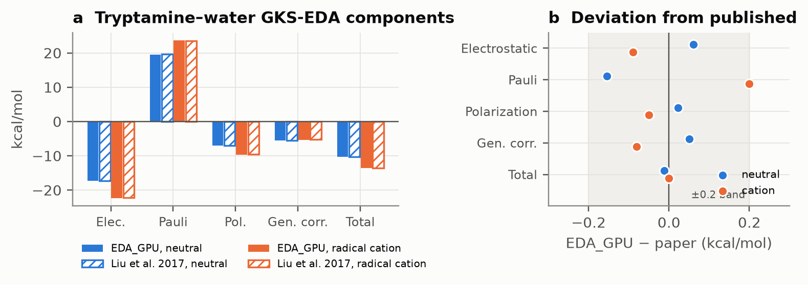
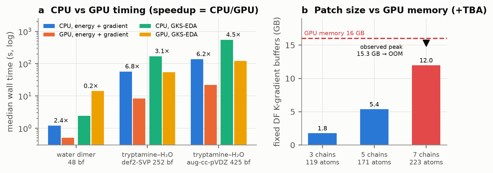
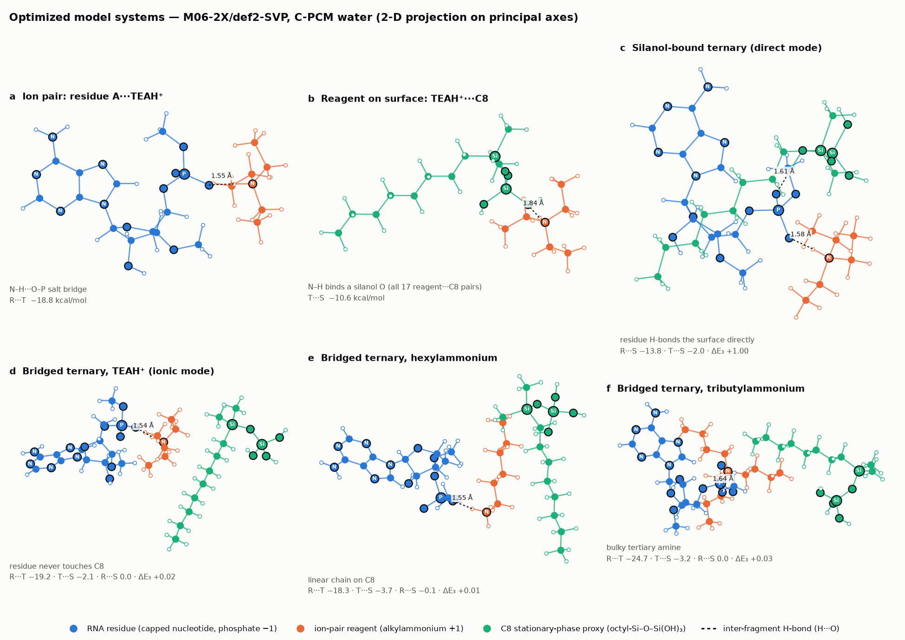
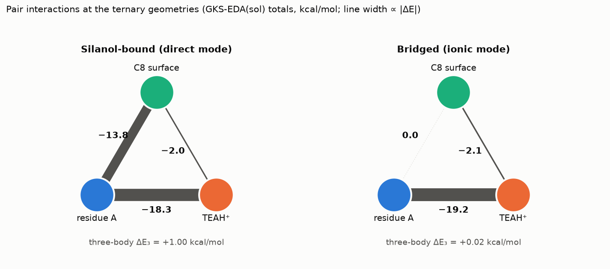
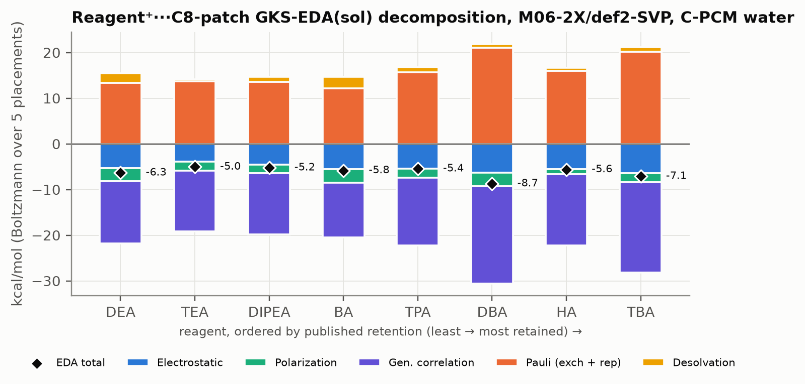
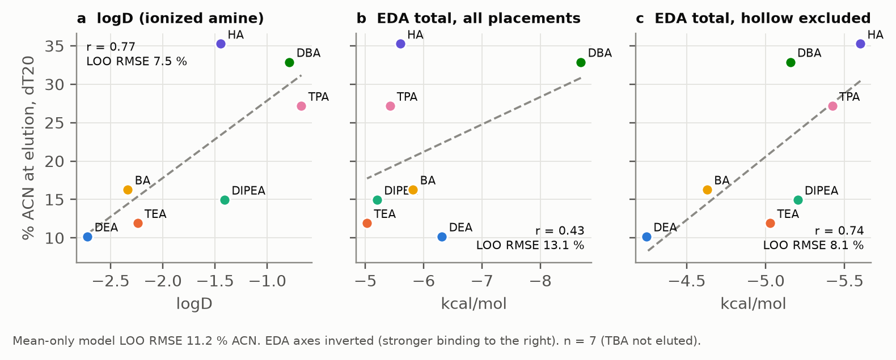
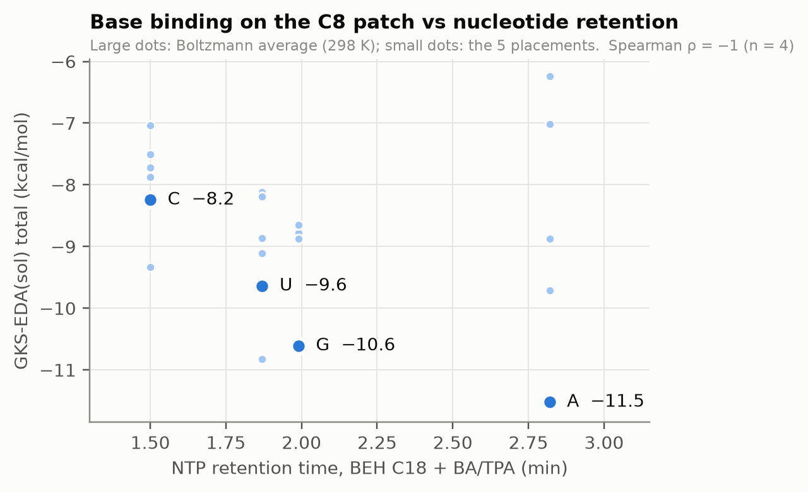

# EDA_GPU: GPU-accelerated GKS-EDA and its application to ion-pair reversed-phase HPLC of RNA

**Research report — last updated 2026-11-20. Status: early research prototype under active development.**

## Abstract

EDA_GPU is an independent implementation of generalized Kohn–Sham energy decomposition analysis (GKS-EDA) and its
implicit-solvent extension GKS-EDA(sol). It is built on PySCF (CPU), GPU4PySCF (GPU) and geomeTRIC (geometry
optimization).
- **Validation.** The gas-phase decomposition reproduces the published tryptamine–water benchmark (Liu et al. 2017) to
  ≤ 0.20 kcal/mol per component. CPU and GPU results agree to 1.8 × 10⁻⁸ Eh per component, and energies and gradients
  agree with Psi4.
- **Application.** The method is applied to ion-pair reversed-phase (IP-RP) HPLC of RNA. Capped nucleotide residues,
  alkylammonium ion-pair reagents and C8 stationary-phase models were optimized at M06-2X/def2-SVP in C-PCM water,
  then decomposed. Results are compared with published retention data.
- **Bases.** On a silanol-free three-chain C8 patch, the Boltzmann-averaged EDA total ranks the four RNA bases
  C < U < G < A. This matches the nucleotide retention order measured on C18 (Spearman ρ = −1, n = 4). Purines put more
  ring atoms in contact with the alkyl chains. Most of this binding (15 of 20 placements) happens with the base slotted
  into the open central hollow of the 3-chain model. Off-centre placements alone (1–2 per base) do not reproduce the
  order.
- **Reagents.** The reagent series is reproduced only partly (ρ 0.45–0.7). No EDA descriptor predicts the published
  elution % acetonitrile better than the reagents' logD.

All application results are exploratory. They come from small models with 5 placements per complex and have no
external validation of the solvated decomposition.

## Key findings

| # | Finding | Evidence |
| --- | --- | --- |
| 1 | Gas-phase GKS-EDA matches published values to ≤ 0.20 kcal/mol per component (neutral and radical cation) | [§3.2](#32-published-benchmark-tryptaminewater) |
| 2 | The GPU is 3–7× faster than the CPU from ~250 basis functions; the 16 GB GPU limits models to the 3-chain patch | [§3.4](#34-performance-and-hardware-limits) |
| 3 | The ion-pair energy per phosphate is almost base-independent; the reagent holds the residue "at arm's length" | [§4.2](#42-ion-pairs-and-ternary-complexes) |
| 4 | Reagent order on the C8 patch: ρ = 0.7 (n = 5), 0.45 (n = 8); logD explains elution better than any EDA descriptor | [§4.3–4.4](#43-reagents-on-the-c8-patch) |
| 5 | Base order on the C8 patch, C < U < G < A, matches measured NTP retention (the silanol model inverted it), but only through bases inserted into the patch's central hollow | [§4.5](#45-rna-bases-on-the-c8-patch-vs-nucleotide-retention) |

## Contents

1. [Introduction and aims](#1-introduction-and-aims)
2. [Methods](#2-methods)
3. [Validation](#3-validation)
4. [Application: IP-RP HPLC of RNA](#4-application-ip-rp-hplc-of-rna)
5. [Discussion and limitations](#5-discussion-and-limitations)
6. [Conclusions and next steps](#6-conclusions-and-next-steps)
7. [Reproducing the results](#7-reproducing-the-results)
8. [Appendix: implementation notes](#8-appendix-implementation-notes)
9. [References](#scientific-references-research-papers-and-websites)

## 1. Introduction and aims

GKS-EDA (Su, Jiang, Chen & Wu 2014; review Su, Tang & Wu 2020) splits an interaction energy into electrostatic,
exchange, repulsion, polarization, generalized correlation and dispersion terms on a Kohn–Sham footing. A solvent
extension adds a desolvation term. The reference implementation is the XEDA program.

This project has two aims:

1. **Method.** Build a faithful, documented, CPU-validated implementation of the original GKS-EDA definitions (no
   ALMO-EDA substitution), then accelerate the expensive steps on NVIDIA GPUs.
2. **Application.** Use the decomposition to explain IP-RP HPLC retention of RNA: why some alkylammonium ion-pair
   reagents retain RNA more strongly than others, and how base composition shifts retention.

The project does not claim to be a port of GAMESS or XEDA. It also does not predict retention times.

## 2. Methods

### 2.1 Implementation

| Capability | Status |
| --- | --- |
| Explicit CPU/GPU backend selection | Implemented and tested; a GPU request on a machine without a GPU fails clearly (no silent CPU fallback) |
| XYZ plus identity, protonation, charge, spin and fragment metadata | Implemented with consistency checks |
| DFT single points and analytic nuclear gradients | Tested with density-fitted B3LYP/def2-SVP |
| Geometry optimization (geomeTRIC), frozen atoms and constraints | Tested on CPU and GPU (water, water dimer) |
| Machine-readable results | Settings, units, convergence, versions, hardware, timing, chemical metadata, XYZ trajectories |
| Complete gas-phase GKS-EDA (six terms) | Restricted and unrestricted, CPU and GPU; matches the published benchmark |
| GKS-EDA(sol) with C-PCM / IEF-PCM | CPU and GPU; internal checks pass; external validation pending |
| Three-body decomposition, SMD-CDS nonpolar term, buried SASA | Analysis scripts for the HPLC study |
| Thermal and workload guards | GPU/CPU temperature cooldowns and duty-cycle pacing, recorded in each result |

The CLI provides `inspect`, `singlepoint`, `optimize`, `validate`, `eda-prepare`, `eda`, `monitor` and `status`.

### 2.2 Energy decomposition

`eda` computes electrostatic, exchange, repulsion, polarization (including charge transfer), generalized correlation
and explicit dispersion terms. It uses the Su–Li orbital intermediates on KS orbitals, counterpoise (ghost-basis)
fragment references and direct integrals. Explicit dispersion is zero for the supported functionals, which carry no
dispersion correction. Pauli = exchange + repulsion.

GKS-EDA(sol) (review Eqs. 12–13) runs every reference SCF in a PCM reaction field. It evaluates the gas-phase-form
terms at the SCRF densities. ΔG_desol is the change in electrostatic solvation energy. Monomers sit in the supermolecule
cavity. Two definitions are documented interpretations pending the original derivation
([specification](docs/GKS_EDA_SOL_SPEC.md)). See also [methods](docs/METHODS.md) and the
[GKS-EDA source gate](docs/GKS_EDA_SPEC.md).

### 2.3 Computational setup for the HPLC study

- **Level of theory.** M06-2X/def2-SVP with C-PCM water (ε 78.36, Bondi × 1.2 radii). Optimizations are
  density-fitted (def2-universal-jkfit) on the GPU. GKS-EDA(sol) uses direct integrals.
- **Seeds and sampling.** Seeds are refined with GFN2-xTB/ALPB. Each complex has 5 placements: the two top-ranked docked seeds
  plus the best 3 of an xTB screen of 8 more.
- **Placement weighting.** Placements are weighted by a Boltzmann factor of the optimized C-PCM energy (298 K).
- **Nonpolar term.** The SMD-CDS term (Marenich, Cramer & Truhlar 2009) is evaluated at the complex geometry.
- Models and their limits are described in [HPLC models](docs/HPLC_MODELS.md).

### 2.4 Test computer and software

| Item | Test environment |
| --- | --- |
| CPU | AMD Ryzen 9 5950X; 16 physical cores, 32 logical threads |
| GPU | NVIDIA GeForce RTX 4080 SUPER; 16 GB VRAM (16,376 MiB reported) |
| System memory | 30.25 GiB usable RAM reported by Linux |
| Operating system | Ubuntu 26.04 LTS, x86-64 |
| NVIDIA driver | 595.91.07 |
| Python | 3.12.13 |
| PySCF / GPU4PySCF | 2.14.0 / 1.8.1 |
| CuPy / cuTensor | 14.2.0 / 2.8.1 |
| geomeTRIC | 1.1.1 |

These are the recorded test specifications, not minimum requirements. Exact per-run hardware, versions and settings
are saved in each result JSON.

## 3. Validation

### 3.1 Numerical consistency

- **Test suite.** 37 local tests pass in the latest full suite, including real GPU tests. GitHub CPU CI also passes;
  its GPU test is skipped because the runner has no GPU.
- **CPU/GPU agreement.** Water and water-dimer single-point energies differ by at most 9.21 × 10⁻¹² Eh, and gradients
  by 7.35 × 10⁻⁷ Eh/bohr. Finite-difference gradients agree within 3.59 × 10⁻⁶ Eh/bohr. Frozen-atom displacement is
  below 1.8 × 10⁻¹¹ Å.
- **Cross-program check (not an EDA validation).** HF/DFT energies and analytic gradients (RKS, UKS, exact and
  density-fitted) agree with Psi4 1.11 in 21/21 cases within preset tolerances, up to 425 basis functions. Optimized
  minima agree for water and the water dimer.
- **GKS-EDA, CPU vs GPU.** The largest per-component difference is 1.82 × 10⁻⁸ Eh (water and CO₂ dimers). Independent
  integral, PBE0 and determinant-energy checks pass.

Details: [validation](docs/VALIDATION.md), [scientific results](reports/validation_2026-10-11/result.json).

### 3.2 Published benchmark: tryptamine–water



**Figure 1.** M06-2X/aug-cc-pVDZ counterpoise GKS-EDA of the tryptamine–water dimer, neutral and radical cation
(one electron removed, not protonated), compared with Liu et al. 2017, Table 3. Panel b shows each deviation. All lie
inside ±0.2 kcal/mol.

Neutral dimer, GPU (kcal/mol):

| Component | EDA_GPU | Paper |
|---|---:|---:|
| Electrostatic | −17.279 | −17.34 |
| Pauli | 19.535 | 19.69 |
| Polarization | −7.048 | −7.07 |
| Generalized correlation | −5.489 | −5.54 |
| Total | −10.282 | −10.27 |

- **Agreement.** Totals agree within 0.012 kcal/mol, components within 0.20 kcal/mol, and H-bond geometry within
  0.05 Å. The project owner accepted this on 2026-10-19 as the external component benchmark.
- **Caveat: reconstructed geometry.** The SI has no Cartesian coordinates, so the geometry was rebuilt from the SI
  bonding pattern.
- **Caveat: settings.** The paper does not specify its grid settings.
- **Not shown.** Agreement tighter than ~0.2 kcal/mol is not demonstrated. A matched-settings XEDA comparison was
  prepared (`reports/xeda_matched_2026-10-18/`) but deferred.

### 3.3 Solvated decomposition

Internal checks pass:
- vacuum limit, 1.6 × 10⁻⁹ Eh
- dielectric screening at separation
- CPU/GPU agreement for C-PCM and IEF-PCM, ≤ 9.6 × 10⁻⁹ Eh
- PCM analytic gradients against finite differences

No external validation exists: the XEDA II BH₃–NH₃ example differs strongly and depends on unknown cavity radii.
Solvated results therefore report `scientifically_validated: false`.

### 3.4 Performance and hardware limits



**Figure 2.** (a) Median wall time for energy + gradient and for complete GKS-EDA. The GPU is 3–7× faster than the CPU
from ~250 basis functions and slower for tiny systems. (b) Fixed density-fitting K-gradient buffers for C8 patches
with tributylammonium. The 7-chain patch ran out of the 16 GB of GPU memory (observed peak 15.3 GB), so all HPLC
results use the 3-chain patch.

GPU4PySCF direct J/K uses CPU/GPU hybrid internals, so the workflow is not all-GPU.
[Benchmark data](reports/benchmark_scaling_2026-10-18.json).

## 4. Application: IP-RP HPLC of RNA

### 4.1 Model systems



**Figure 3.** Optimized model systems: capped RNA residue (5′-O-methylphosphodiester, 3′-O-methyl nucleoside; −1),
alkylammonium reagents, and C8 stationary-phase models.

| System | What it models | Cases | Archive (`reports/`) |
| --- | --- | --- | --- |
| Ion pair (residue···reagent) | Phosphate–ammonium salt bridge in solution | 4 bases × TEAH⁺; residue A × 5 reagents | `hplc_ionpair_2026-10-19/`, `hplc_reagents_2026-10-21/` |
| Residue / reagent on a silanol C8 proxy | Direct adsorption on octyldimethylsilyl–O–Si(OH)₃ | 4 bases; 5 reagents (17 placements) | `hplc_surface_2026-10-19/`, `hplc_reagents_2026-10-21/` |
| Silanol-bound ternary | Residue on a silanol, reagent on the phosphate ("direct" mode) | 4 bases × TEAH⁺ | `hplc_ternary_2026-10-20/` |
| Bridged ternary | Reagent chains on C8, residue held only by the reagent ("ionic" mode) | Residue A × 5 reagents | `hplc_bridged_2026-10-22/` |
| Silanol-free 3-chain C8 patch | Three tethered n-octane chains (hydrophobic phase, no polar sites) | 8 reagents × 5 placements; 4 bases × 5 placements | `hplc_patch_*` |

**Reference data.**
- Donegan, Nguyen & Gilar 2022 ([ref. 35](#hplc-retention-literature-comparison-data)): 13 alkylamines, oligo-dT on
  C18, % ACN at elution (Table 4).
- Maurer et al. 2025 ([ref. 36](#hplc-retention-literature-comparison-data)): 13 alkylamines, 200–6000 nt RNA on a
  polymeric column. Its Fig. 9 shows NTP retention on BEH C18 with butylamine/tripropylamine.
- Both papers rank TEA < DIPEA < DBA < HA < TBA.

### 4.2 Ion pairs and ternary complexes

Bridged ternaries with residue A (kcal/mol; R = residue, T = reagent, S = C8 proxy; ΔE₃ = three-body term):

| Reagent | R···T | T···S | R···S | ΔE₃ |
| --- | ---: | ---: | ---: | ---: |
| TEAH⁺ (triethylammonium) | −19.2 | −2.1 | 0.0 | +0.02 |
| DIPEA-H⁺ | −20.0 | −2.6 | −1.0 | −0.30 |
| dibutylammonium | −23.4 | −2.4 | 0.0 | +0.01 |
| hexylammonium | −18.3 | −3.7 | −0.1 | +0.01 |
| tributylammonium | −24.7 | −3.2 | 0.0 | +0.03 |

The silanol-bound TEAH⁺ ternaries give R···S −13.8 to −16.7 and ΔE₃ +1.0 to +1.2 for all four bases.



**Figure 4.** Pair interactions in the direct (silanol-bound) and ionic (bridged) adsorption modes.

- **Length-based separation in the ionic mode.** The ion-pair energy per phosphate barely depends on the base (TEAH⁺:
  A −18.8, C −19.7, G −19.6, U −20.0 kcal/mol). Each phosphate contributes about the same binding, so the column
  effectively counts charges. This matches length-based separation with hydrophobic reagents and the on-off elution of
  long RNA.
- **Mixed-mode picture.** In the bridged complex the residue never touches the ligand (R···S ≈ 0) and energies are
  pairwise additive (ΔE₃ ≈ 0). Only direct contact can discriminate sequences. This is consistent with Donegan's
  finding that weak reagents keep sequence selectivity and strong ones suppress it.
- **Pairing strength does not set the reagent ranking.** Dibutyl- and tributylammonium pair 4–6 kcal/mol more
  strongly than TEAH⁺. Hexylammonium pairs most weakly yet is among the most retained (ρ = 0.4).
- **The silanol proxy is dominated by H-bonds.** Every isolated reagent···C8 pair optimized into an N–H···silanol
  H-bond (−10.6 to −12.7 kcal/mol, against −2 to −4 for chain contact). Maurer's silanol-free column shows the same
  reagent order, so retention must come from hydrophobic contact. This motivated the silanol-free patch.

### 4.3 Reagents on the C8 patch



**Figure 5.** GKS-EDA(sol) components of reagent⁺···C8-patch binding (Boltzmann over 5 placements), ordered by
published retention. Binding is dispersion-like: generalized correlation dominates and electrostatics are small.

- **Order.** Every reagent binds by chain contact (about −5 to −9 kcal/mol). For the original five reagents the order
  is TEAH⁺ < DIPEA-H⁺ < HAA < TBuAA < DBAA. Against the published TEA < DIPEA < DBA < HA < TBA this gives ρ = 0.7
  (p = 0.19), and 0.6 with CDS. DBAA binds too strongly and HAA too weakly
  (`reports/hplc_patch_2026-10-27/`, `reports/hplc_patch_sampling_2026-10-28/`).
- **Robustness.**
  - Solvent radii (Bondi × 1.4): ρ 0.5–0.7.
  - An acetonitrile dielectric changes the EDA by < 0.03 kcal/mol.
  - aug-cc-pVDZ: ρ 0.9 vs def2-SVP.
  - Archives: `reports/hplc_patch_sensitivity_2026-11-10/`, `reports/hplc_patch_augdz_2026-11-11/`.
- **Larger set.** Adding DEA⁺, BA⁺ and TPA⁺ (n = 8) lowers ρ to 0.45. Small DEA⁺ inserts into the open central hollow
  of the 3-chain patch (`reports/hplc_patch_extended_2026-11-11/`).

### 4.4 Reagent retention fit



**Figure 6.** % ACN at elution of dT20 (Donegan 2022) against (a) the reagents' logD, (b) the EDA total over all
placements, and (c) the EDA total excluding hollow-inserted placements. LOO RMSE: mean-only model 11.2 % ACN.

Results:
- No EDA descriptor beats logD (LOO RMSE 7.5 % ACN).
- Excluding hollow placements turns the EDA total from no fit (r 0.43, LOO 13.1) into one about as good as logD
  (r 0.74, LOO 8.1, ρ 0.75–0.83).
- A permutation check over the whole descriptor search finds an equally good fit for a third of shuffled targets.
- dT60 gives the same picture.
- Archive: `reports/hplc_retention_fit_2026-11-11/`.

### 4.5 RNA bases on the C8 patch vs nucleotide retention

The capped residues A, C, G and U were placed on the silanol-free patch with the same protocol (5 placements each).
All 20 optimizations and decompositions succeeded, with topology preserved and closure ≤ 5.7 × 10⁻¹⁰ Eh. The target
data are NTP retention times on C18 with 100 mM BA + 50 mM TPA, read off Maurer 2025 Fig. 9 (±0.03 min):
**CTP 1.50 < UTP 1.87 < GTP 1.99 < ATP 2.82 min**. The same paper states the nucleotide hydrophobicity order
T > A > G > C.



**Figure 7.** GKS-EDA(sol) total for each base on the C8 patch against NTP retention time. Large dots: Boltzmann
average (298 K); small dots: individual placements.

| Descriptor (kcal/mol) | C | U | G | A | ρ vs t_R |
| --- | ---: | ---: | ---: | ---: | ---: |
| EDA total, Boltzmann | −8.25 | −9.64 | −10.61 | −11.52 | **−1.00** |
| EDA total, lowest-energy placement | −7.50 | −10.83 | −10.61 | −11.58 | −0.80 |
| EDA + CDS(water), Boltzmann | −12.10 | −14.35 | −13.84 | −15.87 | −0.80 |
| Base-ring / backbone contacts with chains, best placement | 34 / 36 | 38 / 41 | 61 / 30 | 55 / 25 | |

- **The order is reproduced.** The Boltzmann EDA total gives exactly the measured order (exact permutation p = 1/24,
  one-sided). With the silanol proxy, C bound most strongly (−18.9) because of polar H-bonds. On the hydrophobic patch
  C is the weakest binder.
- **Mechanism.** No single component sets the order. Purines lay more ring atoms flat on the chains, gaining
  generalized correlation (dispersion-like) energy. A also pays the least Pauli repulsion and desolvation.
- **Robustness.**
  - Dropping any one placement keeps ρ = −1 in 19 of 20 cases.
  - A within-base placement bootstrap gives the exact order in 49 % of resamples.
  - Adding CDS swaps U and G.
  - The U/G and G/A gaps (~1 kcal/mol) are smaller than the spread between placements (4–5 kcal/mol). A > G > U > C is
    therefore the most likely order, not a firm result.
- **Hollow dependence.** 15 of the 20 placements put the base ring inside the patch's central hollow (r < 2.5 Å,
  h < 8 Å). These placements carry nearly all the Boltzmann weight (A 1.00, G 0.99, U 0.88, C 0.45) and alone give
  ρ = −1. The 5 off-centre placements (1–2 per base) give C −7.50, U −9.11, G −8.65, A −7.01 (ρ +0.4). The order
  therefore depends on the base being enclosed by chains. The same model feature made DEA⁺ an outlier in §4.3.
- **Selection.** The EDA total was the headline descriptor in the earlier reagent work, so it was not chosen after
  seeing these data. Among the 4 headline descriptors, a shuffled order matches perfectly 8 % of the time. Among all 40
  energy descriptors examined, it does 67 % of the time.

Archive: `reports/hplc_patch_bases_2026-11-20/`.

## 5. Discussion and limitations

- **Model versus experiment.**
  - The base comparison pairs a −1 capped monophosphate on a bare 3-chain C8 patch with −4 triphosphates ion-paired
    on C18. It tests only whether base–chain contact alone can rank the bases.
  - The model uses U, while T (in "T > A > G > C") has an extra methyl.
- **The central hollow.** The 3-chain patch's open hollow drives both the DEA⁺ reagent outlier and the base order.
  Whether a real C18 phase offers comparable enclosing sites (for example, at lower ligand density) is not known from
  these models.
- **Statistics.** With n = 4 bases and 5–8 reagents, no correlation is statistically established. Gaps between
  neighbouring species are often smaller than the spread between placements.
- **Patch size.** The 3-chain patch has an open central hollow that small reagents fall into. It also cannot represent
  chain packing, which probably explains why linear amines (HA) are more retained, and branched ones (DIPEA) less, than
  logD predicts. Larger brushes exceed the 16 GB GPU (§3.4).
- **Solvent model.** C-PCM has no cavitation term. The SMD-CDS term in water adds only 4–6 cal mol⁻¹ Å⁻² of buried
  nonpolar area, against ≈ 25 from alkane transfer, and changes no reagent rank (`reports/hplc_nonpolar_2026-10-26/`).
- **Not modelled.** HFIP, counter-anions, explicit acetonitrile, reagent concentration and micelles (Maurer's
  100–200 mM plateau), RNA secondary structure, and reagent mixtures.
- **Validation of the solvated decomposition** is internal only (§3.3).

## 6. Conclusions and next steps

GKS-EDA is implemented on CPU and GPU and reproduces published gas-phase components to ≤ 0.2 kcal/mol. For HPLC, the
decomposition gives a consistent molecular picture: retention through the reagent is length-based and
base-independent, and direct base contact with a hydrophobic phase discriminates purines from pyrimidines. On a
silanol-free C8 patch the base order matches measured nucleotide retention, but only for bases enclosed in the
patch's central hollow. The reagent order matches only partly and is no better than logD.

Open directions:
1. Compare with retention data measured at different base ratios (the user's own data; template in
   `examples/hplc/retention_template.csv`).
2. More off-centre placements per base (on the flat chain surface), to test whether the base order survives without
   the hollow.
3. Re-sample DEA/BA/DBA away from the patch's central hollow.
4. Phosphorothioate vs phosphate ion pairs, and HFIP pairing with each reagent.
5. External validation of GKS-EDA(sol) against XEDA with matched cavities.

## 7. Reproducing the results

### Install

Use Python 3.12 in an isolated environment; do not upgrade system Python or drivers.

```bash
# CPU only
python -m pip install -r requirements-cpu-lock.txt -e '.[test]'
# GPU host (exact pins verified on the test computer)
/home/zyliu/anaconda3/bin/conda create -p "$PWD/.env" python=3.12 pip -y
.env/bin/python -m pip install -r requirements-gpu-lock.txt -e '.[test]'
source scripts/gpu-env.sh   # exposes the environment's NVIDIA wheel libraries without touching the system loader
```

CUDA wheel names depend on driver/runtime compatibility. CUDA 12 runtimes can coexist with a host CUDA 13 toolkit.

### Basic usage

```bash
source scripts/gpu-env.sh
.env/bin/eda-gpu inspect
.env/bin/eda-gpu singlepoint examples/water.xyz --metadata examples/water.json --backend cpu --output runs/water_sp
.env/bin/eda-gpu optimize examples/water_dimer.xyz --metadata examples/water_dimer.json --backend gpu --output runs/dimer_gpu
.env/bin/eda-gpu eda examples/water_dimer.xyz --metadata examples/water_dimer.json --backend gpu --output runs/gks_dimer_gpu
.env/bin/eda-gpu eda examples/water_dimer.xyz --metadata examples/water_dimer.json --backend gpu \
  --xc pbe0 --solvent cpcm --output runs/gks_sol_dimer
.env/bin/eda-gpu validate --gpu --output runs/validation
.env/bin/python -m pytest -q
```

- Output directories must be new, so existing work is never overwritten.
- A failed calculation still writes `result.json` with the error and returns nonzero.
- GPU failures never fall back to the CPU.

**Input metadata.** JSON metadata requires identity, protonation, integer charge, spin (Nα − Nβ, not multiplicity) and
a complete fragment partition with charges and spins. Atom indices are zero-based; geomeTRIC constraint files are
one-based.

**Results.** Energies are recorded in hartree, gradients in hartree/bohr and coordinates in ångström. Convergence
establishes a stationary point, not a minimum; no vibrational analysis is performed.

### HPLC pipeline (bases example)

```bash
runs/queue_hplc_patch_bases.full.sh   # xTB pre-opt + DFT opt + GKS-EDA(sol), xTB screen, nonpolar term, analysis
.env/bin/python scripts/analyze_hplc.py runs/hplc_patch_bases_cpcm_def2svp --output runs/hplc_patch_bases_cpcm_def2svp/analysis.json
.env/bin/python scripts/compare_base_retention.py runs/hplc_patch_bases_cpcm_def2svp \
  --data examples/hplc/maurer2025_fig9_ntp.csv --seeds examples/hplc/patch_bases --output reports/hplc_patch_bases_2026-11-20/base_retention.json
.env/bin/python scripts/fit_patch_retention.py --cases <cases.json> --data examples/hplc/donegan2022_table4.csv --output fit.json
```

### Monitoring

```bash
.env/bin/eda-gpu monitor runs/my-calculation   # live SCF cycles, optimization steps, cooldowns, EDA components
.env/bin/eda-gpu status runs/my-calculation    # one snapshot; --json for machine-readable output
```

For older running jobs, add `--log /path/to/calculation.log`. New calculations write atomic `progress.json` snapshots
and an `events.jsonl` history next to their results.

### Computing limits

**Defaults.** Molecular CLI commands use 16 compute threads and 50 % workload pacing. GPU cooldown runs from 75 °C down
to 65 °C, and CPU cooldown from 85 °C down to 75 °C.

**Options.** `--threads`, `--cpu-core-limit`, `--compute-duty-cycle`, `--gpu-temperature-limit` and
`--cpu-temperature-limit` are configurable; a temperature limit of 0 disables that guard. Checks happen at SCF cycles
and workload boundaries, so a long kernel cannot be interrupted. Pacing is an average target, not a watt cap.

**Hardware settings.** GPU power and clocks are never changed automatically, because `nvidia-smi -pl` affects the
shared GPU. The developer's original power limit was 320 W. An optional temporary CPU frequency cap saves the original
limits and restores them automatically:

```bash
sudo /usr/bin/python3 scripts/cpu_frequency_cap.py apply --max-mhz 3000 --minutes 60
sudo /usr/bin/python3 scripts/cpu_frequency_cap.py restore
```

## 8. Appendix: implementation notes

### A. Experimental CPU EDA preparation (`eda-prepare`)

- **What it computes.** Frozen electrostatics and generalized correlation with direct integrals and ghost-basis
  counterpoise references. It supports two closed-shell fragments with B3LYP/PBE0, on the CPU only.
- **What it reports.** Exchange, repulsion and polarization stay null, and a successful run reports
  `full_eda_available: false`. Use `eda` for the complete calculation.
- **XEDA II CO₂ example.** The partial calculation differs from the official example beyond printed rounding. The
  example's settings are not fully specified, and Cartesian functions explain most of the gap.
- **Links.** [Comparison evidence](reports/eda_preparation_2026-10-11/co2_reference_comparison.json),
  [source audit](docs/EDA_SOURCE_AUDIT_2026-10-11.md).

```bash
.env/bin/eda-gpu eda-prepare examples/co2_dimer_xeda_ii.xyz --metadata examples/co2_dimer_xeda_ii.json --backend cpu --basis '6-31g*' --output runs/eda_co2
```

### B. Complete GKS-EDA result flags

- **Gas-phase results** state `all_components_computed: true` and `scientifically_validated: true`. The second flag
  reflects the published-benchmark agreement.
- **`full_eda_available`** stays false. It is reserved for a matched-settings XEDA comparison, which has not been run.
- **Solvated results** state `scientifically_validated: false`.
- **Tiny-system timings.** For tiny systems the GPU is slower: median complete EDA takes 24.43 s on GPU vs 3.15 s on
  CPU for the water dimer ([timings](reports/gks_eda_gpu_2026-10-11/result.json)).

```bash
.env/bin/python scripts/validate_gks.py --gpu --repeats 3 --output runs/gks_checks
.env/bin/python scripts/validate_gks_sol.py --gpu --output runs/gks_sol_validation
```

### C. Tryptamine–water benchmark details

- **Method.** Liu et al., PCCP 2017: neutral M06-2X and radical-cation U-M06-2X with aug-cc-pVDZ and counterpoise
  EDA. The cation is made by removing one electron. Fragment spins must add up to the complex spin; broken-symmetry
  coupling is out of scope. ⟨S²⟩ is recorded for unrestricted SCFs.
- **Geometry.** `examples/tryptamine_water/constructed_bridge.xyz` is a labelled approximate seed, rebuilt from the SI
  bonding pattern (optional RDKit 2026.9.1).
- **Not claimed.** No ZPE/deformation-corrected D0 and no Hessian certification are claimed.
- **Settings.** SCF thresholds were 10⁻⁹ Eh with an orbital gradient of 10⁻⁶. The closure residual was
  8.45 × 10⁻¹¹ Eh.
- **Archive.** [Archived results](reports/tryptamine_neutral_gpu_2026-10-11/paper_comparison.json).

```bash
.env/bin/python scripts/compare_tryptamine.py --xyz examples/tryptamine_water/constructed_bridge.xyz \
  --metadata examples/tryptamine_water/neutral.json --case A_H2O --opt-density-fitting --output runs/tryptamine_comparison
```

### D. Research attribution

Calculation output, monitoring and JSON results carry this acknowledgement: "If EDA_GPU has benefited your research,
please support us by citing this project and the GKS-EDA publications below." Method attribution includes Peifeng Su
et al., [original GKS-EDA, 2014](https://doi.org/10.1021/jp500405s),
[Su, Tang and Wu review, 2020](https://doi.org/10.1002/wcms.1460), and
[Su and Li orbital derivation, 2009](https://doi.org/10.1063/1.3159673). Tryptamine runs also cite
[Liu et al., 2017](https://doi.org/10.1039/C7CP03491A).

## Scientific references, research papers, and websites

If EDA_GPU has benefited your research, please cite
[this project](https://github.com/zyliu-OU/EDA_GPU) with the version or commit used,
the GKS-EDA publications, and the software, functional, and basis-set papers relevant
to your calculation. The bibliography below covers the current implementation,
documented benchmarks, and supporting software. Each entry explains its role.

### GKS-EDA theory and reference program

1. **Su, P.; Li, H. (2009).** “Energy decomposition analysis of covalent bonds and
   intermolecular interactions.” *Journal of Chemical Physics* **131**, 014102.
   [DOI: 10.1063/1.3159673](https://doi.org/10.1063/1.3159673).
   Supplies the orbital intermediate energy expressions used by the experimental implementation.
   [University of Nebraska institutional record](https://digitalcommons.unl.edu/chemfacpub/22/).
2. **Su, P.; Jiang, Z.; Chen, Z.; Wu, W. (2014).** “Energy Decomposition Scheme
   Based on the Generalized Kohn–Sham Scheme.” *Journal of Physical Chemistry A*
   **118**, 2531–2542. [DOI: 10.1021/jp500405s](https://doi.org/10.1021/jp500405s).
   Original GKS-EDA method paper and the project's intended decomposition.
3. **Su, P.; Tang, Z.; Wu, W. (2020).** “Generalized Kohn-Sham energy
   decomposition analysis and its applications.” *WIREs Computational Molecular
   Science* **10**, e1460. [DOI: 10.1002/wcms.1460](https://doi.org/10.1002/wcms.1460).
   Review used to map KS orbital intermediates, component definitions, and generalized correlation.
4. **Tang, Z.; Song, Y.; Zhang, S.; Wang, W.; Xu, Y.; Wu, D.; Wu, W.; Su, P.
   (2021).** “XEDA, a fast and multipurpose energy decomposition analysis program.”
   *Journal of Computational Chemistry* **42**, 2341–2351.
   [DOI: 10.1002/jcc.26765](https://doi.org/10.1002/jcc.26765).
   Reference-program publication; the current comparisons use published manual data.

Official reference resources:

- [XEDA documentation and tutorials](https://xmvb.xmu.edu.cn/docs/xeda/),
  including the [web manual, examples, and citation guidance](https://xmvb.xmu.edu.cn/docs/xeda/content.html).
- [XEDA II English manual](https://xmvb.xmu.edu.cn/docs/xeda/_downloads/415e0f39b016129f5cf2eb24dfe28b4f/XEDA_II_en.pdf):
  source of the CO₂ dimer geometry and rounded components in
  [the attributed reference fixture](references/xeda_ii_co2_b3lyp.json).
- [GAMESS XEDA manual](https://xmvb.xmu.edu.cn/docs/xeda/_downloads/222e6e0bd8ccfe3ce8fe39d17fc3eef3/XEDA_gms.pdf):
  reference interface and counterpoise keyword conventions.
- [Xiamen University 2014 publication list](https://pcoss.xmu.edu.cn/2014-paperlist.pdf):
  bibliographic provenance recorded during the source audit.

Source-access history and equation provenance are in the
[source audit](docs/EDA_SOURCE_AUDIT_2026-10-11.md) and
[mathematical specification](docs/GKS_EDA_SPEC.md). The original 2014 full text
has not been authenticated locally; the supplied review and the Su–Li formulas
support the experimental construction. No local XEDA reference execution has
been established. Citations and internal energy closure do not establish external
component validation. Historical transcription and author-upload links are preserved
in those audit documents with their access and reliability limitations.

### Published molecular benchmark

5. **Liu, Z.; Trindle, C. O.; Gu, Q.; Wu, W.; Su, P. (2017).** “Unravelling
   hydrogen bonding interactions of tryptamine–water dimer from neutral to cation.”
   *Physical Chemistry Chemical Physics* **19**, 25260–25269.
   [DOI: 10.1039/C7CP03491A](https://doi.org/10.1039/C7CP03491A).
   Source of the neutral/radical-cation M06-2X/aug-cc-pVDZ comparison and Table 3
   component values in [the attributed benchmark fixture](references/tryptamine_water_2017.json).
   [Publisher article and supporting-information navigation](https://pubs.rsc.org/en/content/articlelanding/2017/cp/c7cp03491a);
   [four-page supporting information](https://www.rsc.org/suppdata/c7/cp/c7cp03491a/c7cp03491a2.pdf).
   The supplied SI has no complete Cartesian geometries; comparisons using the
   constructed seed remain exploratory.

### Electronic structure, optimization, and numerical software

6. **Sun, Q., et al. (2018).** “PySCF: the Python-based simulations of chemistry
   framework.” *WIREs Computational Molecular Science* **8**, e1340.
   [DOI: 10.1002/wcms.1340](https://doi.org/10.1002/wcms.1340).
   CPU electronic-structure foundation.
7. **Sun, Q., et al. (2020).** “Recent developments in the PySCF program package.”
   *Journal of Chemical Physics* **153**, 024109.
   [DOI: 10.1063/5.0006074](https://doi.org/10.1063/5.0006074).
   PySCF methods and program development. Also see **Sun, Q., et al. (2026)**,
   “The Python simulations of chemistry framework: 10 years of an open-source
   quantum chemistry project,” *Journal of Chemical Physics* **165**, 102502,
   listed on the [official citation page](https://pyscf.org/about.html#how-to-cite).
8. **Sun, Q. (2015).** “Libcint: An efficient general integral library for Gaussian
   basis functions.” *Journal of Computational Chemistry* **36**, 1664–1671.
   [DOI: 10.1002/jcc.23981](https://doi.org/10.1002/jcc.23981).
   Gaussian-integral library underlying PySCF.
9. **Li, R.; Sun, Q.; Zhang, X.; Chan, G. K.-L. (2024).** “Introducing
   GPU-acceleration into the Python-based Simulations of Chemistry Framework.”
   [arXiv:2407.09700](https://arxiv.org/abs/2407.09700).
   GPU4PySCF reference listed by its official repository.
10. **Wu, X., et al. (2024).** “Enhancing GPU-acceleration in the Python-based
    Simulations of Chemistry Framework.”
    [arXiv:2404.09452](https://arxiv.org/abs/2404.09452).
    Additional GPU4PySCF reference listed by its official repository.
11. **Wang, L.-P.; Song, C. (2016).** “Geometry optimization made simple with
    translation and rotation coordinates.” *Journal of Chemical Physics* **144**,
    214108. [DOI: 10.1063/1.4952956](https://doi.org/10.1063/1.4952956).
    geomeTRIC optimizer and TRIC coordinates;
    [2022 erratum](https://doi.org/10.1063/5.0102029).
12. **Lehtola, S.; Steigemann, C.; Oliveira, M. J. T.; Marques, M. A. L. (2018).**
    “Recent developments in Libxc — A comprehensive library of functionals for
    density functional theory.” *SoftwareX* **7**, 1–5.
    [DOI: 10.1016/j.softx.2017.11.002](https://doi.org/10.1016/j.softx.2017.11.002).
    Exchange-correlation functional library used through the calculation backends.
13. **Harris, C. R., et al. (2020).** “Array programming with NumPy.” *Nature*
    **585**, 357–362. [DOI: 10.1038/s41586-020-2649-2](https://doi.org/10.1038/s41586-020-2649-2).
    CPU arrays, density algebra, and result processing.
14. **Virtanen, P., et al. (2020).** “SciPy 1.0: fundamental algorithms for
    scientific computing in Python.” *Nature Methods* **17**, 261–272.
    [DOI: 10.1038/s41592-019-0686-2](https://doi.org/10.1038/s41592-019-0686-2).
    Numerical infrastructure used by the scientific software stack.

Official software websites and implementation documentation:

- **PySCF:** [website](https://pyscf.org/), [source](https://github.com/pyscf/pyscf),
  [geometry optimization](https://pyscf.org/user/geomopt.html),
  [GPU interface](https://pyscf.org/user/gpu.html), and
  [density fitting](https://pyscf.org/user/df.html).
- **GPU4PySCF:** [source and citation guidance](https://github.com/pyscf/gpu4pyscf);
  [v1.8.1 direct J/K implementation](https://github.com/pyscf/gpu4pyscf/blob/v1.8.1/gpu4pyscf/scf/hf.py)
  inspected for the CPU/GPU hybrid execution description.
- **geomeTRIC:** [documentation](https://geometric.readthedocs.io/en/latest/),
  [constraints](https://geometric.readthedocs.io/en/latest/constraints.html), and
  [source and citation guidance](https://github.com/leeping/geomeTRIC).
- **Libxc / libcint:** [Libxc website and citations](https://libxc.gitlab.io/),
  [functional definitions](https://libxc.gitlab.io/functionals/), and
  [libcint source](https://github.com/sunqm/libcint).
- **CuPy:** [website](https://cupy.dev/), [documentation](https://docs.cupy.dev/en/stable/),
  and [source](https://github.com/cupy/cupy); GPU arrays and linear algebra.
- **NVIDIA:** [CUDA documentation](https://docs.nvidia.com/cuda/),
  [cuTENSOR documentation](https://docs.nvidia.com/cuda/cutensor/latest/), and
  [NVIDIA System Management Interface](https://docs.nvidia.com/deploy/nvidia-smi/);
  runtime, tensor contractions, and hardware monitoring.
- **NumPy / SciPy:** [NumPy citation guidance](https://numpy.org/citing-numpy/)
  and [SciPy citation guidance](https://scipy.org/citing-scipy/).
- **RDKit (optional seed generation):** [website](https://www.rdkit.org/),
  [overview and citation guidance](https://www.rdkit.org/docs/Overview.html), and
  [source](https://github.com/rdkit/rdkit). Used to construct the labelled approximate
  tryptamine seed; ordinary electronic-structure calculations do not require it.
- **Supporting tools:** [h5py](https://www.h5py.org/),
  [NetworkX](https://networkx.org/), [threadpoolctl](https://github.com/joblib/threadpoolctl),
  and [pytest](https://docs.pytest.org/en/stable/); data handling, optimizer graph
  infrastructure, thread limits, and tests. Exact installed versions are recorded
  in the lock files and calculation results.

### Independent cross-check program

15. **Smith, D. G. A., et al. (2020).** “Psi4 1.4: Open-source software for
    high-throughput quantum chemistry.” *Journal of Chemical Physics* **152**, 184108.
    [DOI: 10.1063/5.0006002](https://doi.org/10.1063/5.0006002).
    Independent program for the energy/gradient cross-check (version 1.11 used);
    [website and citation guidance](https://psicode.org/).

16. **Bannwarth, C.; Ehlert, S.; Grimme, S. (2019).** “GFN2-xTB—An Accurate and Broadly
    Parametrized Self-Consistent Tight-Binding Quantum Chemical Method with Multipole
    Electrostatics and Density-Dependent Dispersion Contributions.” *Journal of Chemical Theory
    and Computation* **15**, 1652–1671. [DOI: 10.1021/acs.jctc.8b01176](https://doi.org/10.1021/acs.jctc.8b01176).
    Seed refinement before DFT optimization in the HPLC model study ([xtb](https://github.com/grimme-lab/xtb)).
17. **Ehlert, S.; Stahn, M.; Spicher, S.; Grimme, S. (2021).** “Robust and Efficient Implicit
    Solvation Model for Fast Semiempirical Methods.” *Journal of Chemical Theory and Computation*
    **17**, 4250–4261. [DOI: 10.1021/acs.jctc.1c00471](https://doi.org/10.1021/acs.jctc.1c00471).
    ALPB implicit solvation used with GFN2-xTB seed refinement.

### Density functionals and counterpoise convention

18. **Boys, S. F.; Bernardi, F. (1970).** “The calculation of small molecular
    interactions by the differences of separate total energies. Some procedures
    with reduced errors.” *Molecular Physics* **19**, 553–566.
    [DOI: 10.1080/00268977000101561](https://doi.org/10.1080/00268977000101561).
    Ghost-basis counterpoise convention for fragment references and BSSE treatment.
19. **Becke, A. D. (1993).** “Density-functional thermochemistry. III. The role of
    exact exchange.” *Journal of Chemical Physics* **98**, 5648–5652.
    [DOI: 10.1063/1.464913](https://doi.org/10.1063/1.464913).
    Three-parameter hybrid construction relevant to B3LYP.
20. **Stephens, P. J.; Devlin, F. J.; Chabalowski, C. F.; Frisch, M. J. (1994).**
    “Ab Initio Calculation of Vibrational Absorption and Circular Dichroism Spectra
    Using Density Functional Force Fields.” *Journal of Physical Chemistry* **98**,
    11623–11627. [DOI: 10.1021/j100096a001](https://doi.org/10.1021/j100096a001).
    B3LYP reference returned by the installed Libxc interface.
21. **Becke, A. D. (1988).** “Density-functional exchange-energy approximation
    with correct asymptotic behavior.” *Physical Review A* **38**, 3098–3100.
    [DOI: 10.1103/PhysRevA.38.3098](https://doi.org/10.1103/PhysRevA.38.3098).
    B88 exchange contribution to B3LYP/B3LYP5.
22. **Lee, C.; Yang, W.; Parr, R. G. (1988).** “Development of the Colle-Salvetti
    correlation-energy formula into a functional of the electron density.”
    *Physical Review B* **37**, 785–789.
    [DOI: 10.1103/PhysRevB.37.785](https://doi.org/10.1103/PhysRevB.37.785).
    LYP correlation contribution to B3LYP/B3LYP5.
23. **Vosko, S. H.; Wilk, L.; Nusair, M. (1980).** “Accurate spin-dependent
    electron liquid correlation energies for local spin density calculations:
    a critical analysis.” *Canadian Journal of Physics* **58**, 1200–1211.
    [DOI: 10.1139/p80-159](https://doi.org/10.1139/p80-159).
    Local correlation and the explicitly recorded B3LYP variant convention.
24. **Perdew, J. P.; Burke, K.; Ernzerhof, M. (1996).** “Generalized Gradient
    Approximation Made Simple.” *Physical Review Letters* **77**, 3865–3868.
    [DOI: 10.1103/PhysRevLett.77.3865](https://doi.org/10.1103/PhysRevLett.77.3865).
    PBE exchange/correlation underlying PBE0 and independent PBE component checks.
25. **Adamo, C.; Barone, V. (1999).** “Toward reliable density functional methods
    without adjustable parameters: The PBE0 model.” *Journal of Chemical Physics*
    **110**, 6158–6170. [DOI: 10.1063/1.478522](https://doi.org/10.1063/1.478522).
    PBE0 global hybrid functional.
26. **Ernzerhof, M.; Scuseria, G. E. (1999).** “Assessment of the
    Perdew–Burke–Ernzerhof exchange-correlation functional.” *Journal of Chemical
    Physics* **110**, 5029–5036.
    [DOI: 10.1063/1.478401](https://doi.org/10.1063/1.478401).
    Companion PBE0 reference returned by the installed Libxc interface.
27. **Zhao, Y.; Truhlar, D. G. (2008).** “The M06 suite of density functionals
    for main group thermochemistry, thermochemical kinetics, noncovalent
    interactions, excited states, and transition elements: two new functionals
    and systematic testing of four M06-class functionals and 12 other functionals.”
    *Theoretical Chemistry Accounts* **120**, 215–241.
    [DOI: 10.1007/s00214-007-0310-x](https://doi.org/10.1007/s00214-007-0310-x).
    M06-2X functional used for the tryptamine–water benchmark and the HPLC study.

### Orbital and auxiliary basis sets

28. **Weigend, F.; Ahlrichs, R. (2005).** “Balanced basis sets of split valence,
    triple zeta valence and quadruple zeta valence quality for H to Rn: Design and
    assessment of accuracy.” *Physical Chemistry Chemical Physics* **7**, 3297–3305.
    [DOI: 10.1039/B508541A](https://doi.org/10.1039/B508541A).
    def2-SVP basis used in the optimization-foundation validation and the HPLC study.
29. **Weigend, F. (2002).** “A fully direct RI-HF algorithm: Implementation,
    optimised auxiliary basis sets, demonstration of accuracy and efficiency.”
    *Physical Chemistry Chemical Physics* **4**, 4285–4291.
    [DOI: 10.1039/B204199P](https://doi.org/10.1039/B204199P).
    Correlation-consistent J/K-fitting auxiliary bases relevant to the
    aug-cc-pVDZ-JKFIT density-fitted optimization path.
30. **Dunning, T. H., Jr. (1989).** “Gaussian basis sets for use in correlated
    molecular calculations. I. The atoms boron through neon and hydrogen.”
    *Journal of Chemical Physics* **90**, 1007–1023.
    [DOI: 10.1063/1.456153](https://doi.org/10.1063/1.456153).
    Correlation-consistent cc-pVDZ foundation.
31. **Kendall, R. A.; Dunning, T. H., Jr.; Harrison, R. J. (1992).** “Electron
    affinities of the first-row atoms revisited. Systematic basis sets and wave
    functions.” *Journal of Chemical Physics* **96**, 6796–6806.
    [DOI: 10.1063/1.462569](https://doi.org/10.1063/1.462569).
    Diffuse augmentation underlying aug-cc-pVDZ in the molecular benchmark.
32. **Hehre, W. J.; Ditchfield, R.; Pople, J. A. (1972).** “Self—Consistent
    Molecular Orbital Methods. XII. Further Extensions of Gaussian—Type Basis
    Sets for Use in Molecular Orbital Studies of Organic Molecules.”
    *Journal of Chemical Physics* **56**, 2257–2261.
    [DOI: 10.1063/1.1677527](https://doi.org/10.1063/1.1677527).
    6-31G basis underlying the XEDA CO₂ example.
33. **Hariharan, P. C.; Pople, J. A. (1973).** “The influence of polarization
    functions on molecular orbital hydrogenation energies.” *Theoretica Chimica
    Acta* **28**, 213–222.
    [DOI: 10.1007/BF00533485](https://doi.org/10.1007/BF00533485).
    Polarization functions relevant to the example's 6-31G* basis.
34. **Weigend, F. (2008).** “Hartree–Fock exchange fitting basis sets for H to Rn.”
    *Journal of Computational Chemistry* **29**, 167–175.
    [DOI: 10.1002/jcc.20702](https://doi.org/10.1002/jcc.20702).
    Universal J/K-fitting auxiliary basis family used as def2-universal-jkfit
    in the optimization-foundation calculations.

Basis definitions and their source references can also be inspected through
[PySCF basis documentation](https://pyscf.org/user/gto.html#basis-set) and the
[Basis Set Exchange](https://www.basissetexchange.org/). Spherical/Cartesian
representation, auxiliary basis, and installed functional definitions must be
reported with each result because these choices affect comparison with published data.

### HPLC retention literature (comparison data)

35. **Donegan, M.; Nguyen, J. M.; Gilar, M. (2022).** “Effect of ion-pairing reagent hydrophobicity on
    liquid chromatography and mass spectrometry analysis of oligonucleotides.” *Journal of
    Chromatography A* **1666**, 462860.
    [DOI: 10.1016/j.chroma.2022.462860](https://doi.org/10.1016/j.chroma.2022.462860).
    Source of the % acetonitrile at elution and the reagent hydrophobicity order used in the
    reagent comparison ([§4.4](#44-reagent-retention-fit)).
36. **Maurer, J.; Malburet, C.; François-Heude, M.; Guillarme, D. (2025).** “Evaluation of ion pairing
    reversed-phase liquid chromatography for the separation of large RNA molecules.” *Journal of
    Chromatography A* **1740**, 465574.
    [DOI: 10.1016/j.chroma.2024.465574](https://doi.org/10.1016/j.chroma.2024.465574).
    Reagent classification and large-RNA retention on a silanol-free polymeric column; Fig. 9 NTP
    retention times used in the base comparison ([§4.5](#45-rna-bases-on-the-c8-patch-vs-nucleotide-retention)).
37. **Marenich, A. V.; Cramer, C. J.; Truhlar, D. G. (2009).** “Universal solvation model based on solute
    electron density and on a continuum model of the solvent defined by the bulk dielectric constant and
    atomic surface tensions.” *Journal of Physical Chemistry B* **113**, 6378–6396.
    [DOI: 10.1021/jp810292n](https://doi.org/10.1021/jp810292n).
    SMD-CDS nonpolar term evaluated for the HPLC complexes.

### Project terms

This repository is public for development visibility. No project license has been
assigned yet. Published literature and manuals are linked; full-text papers are
not redistributed in this repository. Software projects retain their own licenses
and citation guidance.
